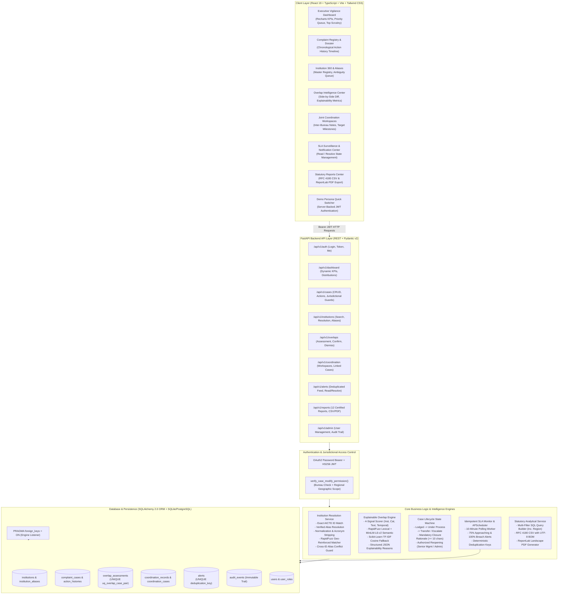
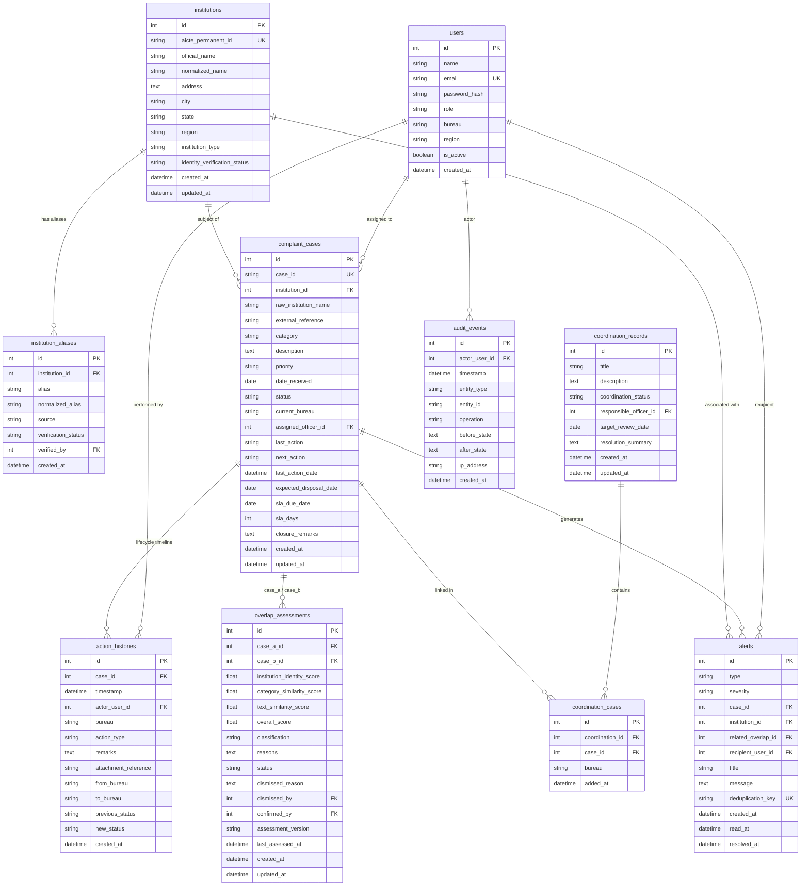
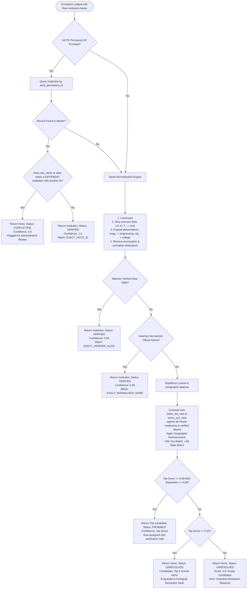
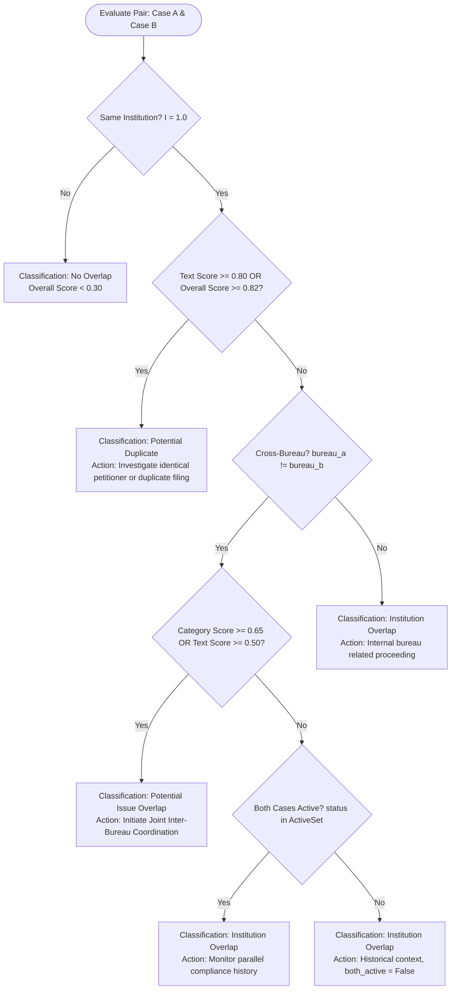
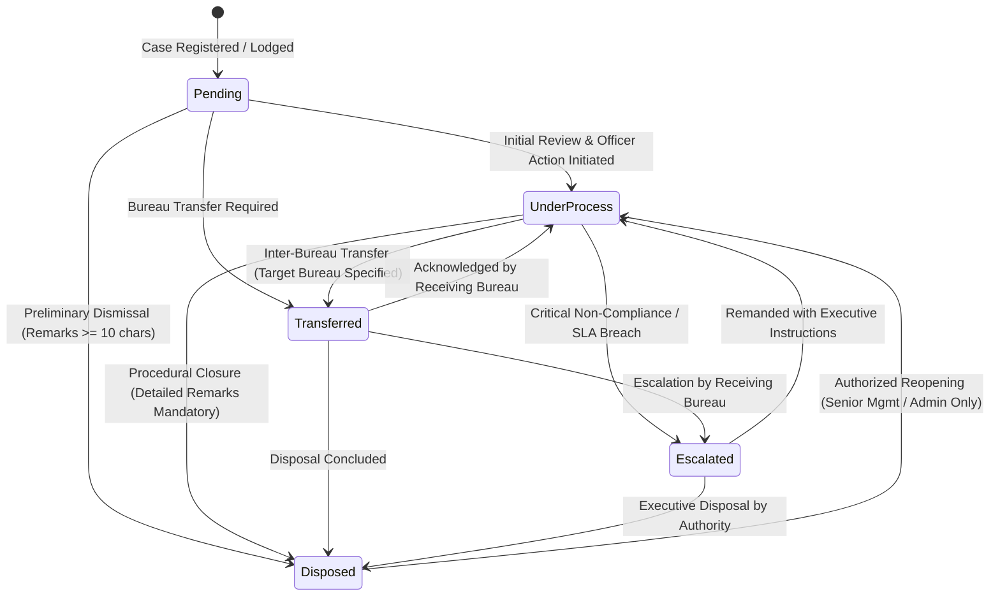
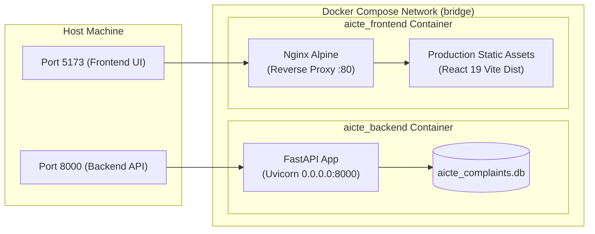

# Architecture & Technical Specification
## SIH26264: Integrated AICTE Institution Complaint Monitoring and Coordination System

---

### 1. Executive System Overview

The All India Council for Technical Education (AICTE) receives complaints concerning technical education institutions across multiple distinct regulatory cells and administrative divisions:
- **Regulation Bureau (RB)**: Handles statutory standard violations, faculty cadre ratio discrepancies, and unauthorized courses under the AICTE Act.
- **Public Grievance Redressal Cell (PGRC)**: Investigates student petitions, capitation fees, fee refund disputes, and harassment allegations.
- **Regional Offices (RO)**: Oversees territorial compliance, field inspections, and regional inquiries across Northern, Western, Southern, Eastern, Central, and other zones.
- **Approval Bureau**: Manages annual institutional approvals, intake quotas, and extension of approvals (EoA).

Historically, these units operated in technological and operational silos. Multiple bureaus frequently handled complaints concerning the same institution simultaneously without knowledge of parallel proceedings, leading to contradictory orders, duplicate inspection notices, statutory SLA breaches, and fragmented institutional accountability.

The **Integrated AICTE Institution Complaint Monitoring and Coordination System** solves this problem by providing:
1. **Deterministic Institution Identity Resolution**: A 4-tier resolution pipeline with phonetic, lexical, and geographic reinforcement that disambiguates informal names, common acronyms, and address discrepancies while preventing the conflation of distinct institutions.
2. **Explainable Overlap Detection Engine**: A multi-signal hybrid intelligence engine (lexical + semantic transformer with TF-IDF fallback) that detects cross-bureau case intersections with transparent scoring and structured rationale.
3. **Cross-Bureau Coordination Workspace**: Shared inter-bureau working environments allowing designated case officers to align actions, schedule joint hearings, and issue synchronized directives while preserving bureau case autonomy.
4. **Idempotent SLA Surveillance & Escalation Guardian**: Background scheduler (APScheduler) monitoring statutory deadlines, generating deduplicated alerts for impending and breached deadlines.
5. **Strict Server-Side Jurisdictional RBAC**: Enforced server-side checks restricting case mutations to authorized bureau and regional officers while providing council-wide read visibility for situational awareness.

---

### 2. High-Level System Architecture Diagram



---

### 3. Detailed Data Architecture & Relational Schema

The persistence layer is implemented using **SQLAlchemy 2.0 Declarative ORM** with SQLite/PostgreSQL compatibility. Relational integrity is enforced at the database connection level via `PRAGMA foreign_keys = ON`.



---

### 4. Institution Identity Resolution Pipeline

The institution identity resolution pipeline solves a key challenge in Indian technical education regulatory filings: complaints often reference institutions by informal abbreviations ("VESIT"), colloquial acronyms ("COEP Pune"), historical university departments, or misspelled names without citing the formal AICTE Permanent ID.



#### Pipeline Invariants & Safety Guarantees:
- **No Silent Merging**: Distinct institutions possessing different AICTE Permanent IDs are never merged automatically, regardless of fuzzy name similarity.
- **Alias Conflict Protection**: If a complaint submits an AICTE Permanent ID for Institution A but supplies a name or alias registered to Institution B, the pipeline flags a `CONFLICTING` status and refuses automated resolution.
- **Audit Logging**: Any manual resolution from the ambiguity queue generates an immutable `ActionHistory` record and an `AuditEvent` logging the resolving officer's ID, previous state, and updated institution link.

---

### 5. Explainable Overlap Engine Architecture

The overlap engine evaluates intersections between complaint cases to identify duplicate filings and cross-bureau regulatory overlap. The engine acts as an explainable decision-support system, providing transparent scoring and structured rationale to authorized officers.

#### Mathematical Formulation & Signal Weights:
For any two complaint cases $C_a$ and $C_b$ (ordered such that $\text{id}(C_a) < \text{id}(C_b)$):

1. **Institution Identity Factor ($I$)**:
   $$I = \begin{cases} 1.0 & \text{if } \text{inst\_id}(C_a) = \text{inst\_id}(C_b) \land \text{inst\_id} \neq \text{None} \\ 0.0 & \text{otherwise} \end{cases}$$

2. **Category Similarity Factor ($S_{\text{cat}}$)**:
   $$S_{\text{cat}} = \begin{cases} 1.0 & \text{if } \text{cat}(C_a) = \text{cat}(C_b) \\ 0.65 & \text{if } \text{cluster}(\text{cat}(C_a)) = \text{cluster}(\text{cat}(C_b)) \\ 0.15 & \text{otherwise} \end{cases}$$
   *Clusters*: Academic, Financial, Infrastructure, Conduct.

3. **Text Similarity Factor ($S_{\text{text}}$)**:
   - **Lexical Score ($L$)**:
     $$L = \max\left(\frac{\text{token\_set\_ratio}(D_a, D_b)}{100}, \frac{\text{token\_sort\_ratio}(D_a, D_b)}{100}\right)$$
   - **Semantic Score ($S_{\text{sem}}$)**: Computed using the sentence transformer model `all-MiniLM-L6-v2`:
     $$S_{\text{sem}} = \frac{\mathbf{e}_a \cdot \mathbf{e}_b}{\|\mathbf{e}_a\| \|\mathbf{e}_b\|}$$
   - **Hybrid Blended Text Score**:
     $$S_{\text{text}} = \begin{cases} 0.60 \times S_{\text{sem}} + 0.40 \times L & \text{if transformer available} \\ \max(L, 0.30 \times S_{\text{tfidf}} + 0.70 \times L) & \text{if } L \ge 0.70 \text{ (TF-IDF fallback)} \\ 0.50 \times S_{\text{tfidf}} + 0.50 \times L & \text{otherwise} \end{cases}$$

4. **Composite Overall Score ($S_{\text{overall}}$)**:
   $$S_{\text{overall}} = \begin{cases} 0.35 \times S_{\text{cat}} + 0.65 \times S_{\text{text}} & \text{if } I = 1.0 \\ 0.10 \times S_{\text{cat}} + 0.20 \times S_{\text{text}} & \text{if } I = 0.0 \end{cases}$$

#### Classification Decision Tree:



#### Structured Explainability JSON Schema:
Every row in `overlap_assessments` persists a structured JSON reasoning payload in the `reasons` column:
```json
{
  "headline": "POTENTIAL ISSUE OVERLAP: COORDINATION REQUIRED",
  "institution_identity": {
    "score": 1.0,
    "institution_id": 1,
    "institution_name": "Vivekanand Education Society's Institute of Technology",
    "aicte_id": "1-10023451",
    "evidence": "Verified AICTE ID and institution master match"
  },
  "cross_bureau": {
    "is_cross_bureau": true,
    "bureau_a": "Public Grievance Redressal Cell (PGRC)",
    "bureau_b": "Regulation Bureau (RB)"
  },
  "case_statuses": {
    "case_a": { "case_id": "AICTE-PGRC-2026-00010", "status": "Under Process", "officer": "Smt. Sunita Verma" },
    "case_b": { "case_id": "AICTE-RB-2026-00011", "status": "Under Process", "officer": "Dr. Rajesh Sharma" },
    "both_active": true
  },
  "similarity_metrics": {
    "category_score": 1.0,
    "text_score": 0.485,
    "text_method": "TFIDF_LEXICAL_FALLBACK",
    "overall_score": 0.665
  },
  "narrative_explanation": "Verified institution match: Both cases concern 'VESIT'. Cross-Bureau involvement detected between 'PGRC' and 'RB'. Both cases are currently active. Category relationship: 'Faculty Deficiencies' vs 'Faculty Deficiencies' (Score: 100%).",
  "recommended_action": "Initiate cross-bureau coordination between PGRC and RB to align proceedings."
}
```

---

### 6. Case Lifecycle State Machine & Workflow Engine

The case workflow enforces statutory procedural stages, transactional integrity, and append-only auditability.



#### Workflow Invariants:
1. **Mandatory Disposal Remarks**: Transition to `Disposed` strictly requires `closure_remarks` of at least 10 non-whitespace characters.
2. **Authorized Reopening Barrier**: Only users possessing the `Senior Management` or `Admin` role can reopen a `Disposed` case. Case reopening re-activates overlap evaluations.
3. **No Historical Modification**: Historical action records in `action_histories` cannot be updated or deleted through any API endpoint.
4. **Transactional Boundary**: Case attribute mutations, `ActionHistory` additions, and `AuditEvent` records are wrapped in a database transaction (`db.commit()`), rolling back in the event of an unhandled failure.

---

### 7. SLA Surveillance & Alerting Architecture

Statutory compliance deadlines (e.g., 30 days for standard grievances, 15 days for critical safety or ragging complaints) are safeguarded by an idempotent background scheduler.

```mermaid
flowchart TD
    Scheduler([APScheduler Interval Trigger: Every 10 Minutes]) --> QueryCases[Query Active Cases\nstatus IN Pending, Under Process, Escalated, Transferred]
    
    QueryCases --> Loop{For Each Case}
    Loop --> NullCheck{sla_due_date IS NULL?}
    NullCheck -- Yes --> SkipCase[Defensive Guard: Skip Case]
    
    NullCheck -- No --> CheckBreached{sla_due_date < today?}
    CheckBreached -- Yes --> GenBreach[Dedup Key: SLA_BREACHED_caseID_dueDate\nCheck if Key Exists in alerts Table]
    GenBreach --> BreachInsert{Exists?}
    BreachInsert -- No --> InsertBreach[Insert CRITICAL Alert\nRecipient: assigned_officer_id\nTitle: SLA BREACHED: N days overdue]
    BreachInsert -- Yes --> NextCheck
    
    CheckBreached -- No --> CheckApproaching{sla_due_date <= today + 5 days?}
    CheckApproaching -- Yes --> GenAppr[Dedup Key: SLA_APPROACHING_caseID_dueDate\nCheck if Key Exists]
    GenAppr --> ApprInsert{Exists?}
    ApprInsert -- No --> InsertAppr[Insert HIGH/MEDIUM Alert\nRecipient: assigned_officer_id\nTitle: SLA Approaching: N days left]
    ApprInsert -- Yes --> NextCheck

    CheckApproaching -- No --> NextCheck{status == 'Pending'?}
    NextCheck -- Yes --> CheckIdle{(today - date_received) >= 7 days?}
    CheckIdle -- Yes --> GenIdle[Dedup Key: PENDING_REMINDER_caseID_YYYYWW\nWeekly Reminder Key Check]
    GenIdle --> IdleInsert{Exists?}
    IdleInsert -- No --> InsertIdle[Insert MEDIUM Alert\nRecipient: assigned_officer_id\nTitle: Pending Case Reminder: N days idle]
    IdleInsert -- Yes --> Commit
    NextCheck -- No --> Commit

    Commit[db.commit\nAll New Deduplicated Alerts Persisted] --> EndLoop([Wait for Next Interval])
```

#### Deduplication Key Guarantees:
- `SLA_BREACHED_{case_id}_{due_date}`: Fired once per statutory deadline date.
- `SLA_APPROACHING_{case_id}_{due_date}`: Fired once during the 5-day warning horizon.
- `PENDING_REMINDER_{case_id}_{year_week}`: Weekly periodic reminder.
- `OVERLAP_{case_a}_{case_b}`: Unique per evaluated active pair.
- The unique database constraint on `alerts.deduplication_key` ensures that repeated scheduler executions or multiple application instances cannot insert duplicate notifications.

---

### 8. Role-Based Access Control (RBAC) & Jurisdictional Boundaries

The platform implements a jurisdictional permission model enforced server-side by `verify_case_modify_permission()`.

| Operation | RB Officer | PGRC Officer | Regional Officer | Senior Management | System Admin |
| :--- | :---: | :---: | :---: | :---: | :---: |
| **View Cross-Bureau Cases** | Yes (Read-Only) | Yes (Read-Only) | Yes (Read-Only) | Yes (Read-Only) | Yes (Read-Only) |
| **Update / Action Cases** | Own Bureau Only | Own Bureau Only | RO Bureau & Own Region Only | Council-Wide | Council-Wide |
| **Transfer Cases** | Own Bureau Only | Own Bureau Only | RO Bureau & Own Region Only | Council-Wide | Council-Wide |
| **Escalate Cases** | Own Bureau Only | Own Bureau Only | RO Bureau & Own Region Only | Council-Wide | Council-Wide |
| **Dispose Cases** | Own Bureau Only | Own Bureau Only | RO Bureau & Own Region Only | Council-Wide | Council-Wide |
| **Reopen Disposed Cases** | No (403 Forbidden) | No (403 Forbidden) | No (403 Forbidden) | Yes | Yes |
| **Confirm / Dismiss Overlaps** | Yes | Yes | Yes | Yes | Yes |
| **Manage Coordination Space** | Yes | Yes | Yes | Yes | Yes |
| **Manual Institution Resolution** | No | No | No | Yes | Yes |
| **Export Statutory Reports** | Yes | Yes | Yes | Yes | Yes |
| **View Audit Trail Logs** | No (403 Forbidden) | No (403 Forbidden) | No (403 Forbidden) | Yes | Yes |
| **User Provisioning & Roles** | No (403 Forbidden) | No (403 Forbidden) | No (403 Forbidden) | No (403 Forbidden) | Yes |

#### Server-Side Enforcement Implementation:
```python
def verify_case_modify_permission(user: User, case: ComplaintCase):
    if user.role in ["Admin", "Senior Management"]:
        return

    # Regional Officer jurisdiction check
    if user.role == "Regional Officer":
        if user.region != "All" and case.institution and case.institution.region != user.region:
            raise HTTPException(
                status_code=status.HTTP_403_FORBIDDEN,
                detail=f"Regional jurisdiction error: Your assigned jurisdiction is '{user.region}', but this case concerns an institution in '{case.institution.region}' region."
            )
        if case.current_bureau != "Regional Office (RO)":
            raise HTTPException(
                status_code=status.HTTP_403_FORBIDDEN,
                detail=f"Bureau jurisdiction error: Regional Officers can only modify cases under 'Regional Office (RO)'. This case is currently under '{case.current_bureau}'."
            )
        return

    # Specific Bureau Officer check (Regulation Bureau vs PGRC vs Approval)
    if user.bureau and user.bureau != "All" and user.bureau != case.current_bureau:
        raise HTTPException(
            status_code=status.HTTP_403_FORBIDDEN,
            detail=f"Cross-bureau modification not permitted: Your bureau is '{user.bureau}', but this case is currently under '{case.current_bureau}'. Request inter-bureau transfer or coordination."
        )
```

---

### 9. Statutory Reporting & Analytical Engine

The analytics service generates 12 certified regulatory reports with table preview, streaming RFC 4180 CSV export, and ReportLab PDF document generation:
1. **Detailed Cases Ledger**: Complete case-by-case audit ledger.
2. **Bureau Workload Summary**: Intake, active processing, and disposal across bureaus.
3. **Status Distribution Analysis**: Pending, Under Process, Transferred, Escalated, Disposed metrics.
4. **Ageing Bracket Analysis**: Cases grouped into 0-30, 31-60, 61-90, 90+ day intervals.
5. **SLA Compliance Audit**: Analysis of statutory adherence and breach rates.
6. **Cross-Bureau Overlap Ledger**: Master registry of all evaluated overlap assessments.
7. **Institution Scrutiny Index**: Institutions ranked by complaint frequency and multi-bureau active proceedings.
8. **Inter-Bureau Coordination Summary**: Overview of active collaborative workspaces.
9. **Regional Disposal Performance**: Performance breakdown across AICTE regional offices.
10. **Category Breakdown**: Distribution of allegations (Faculty, Capitation Fees, Infrastructure, Harassment).
11. **Escalated Cases Review**: Cases escalated to senior management.
12. **Historical Disposal Registry**: Archive of concluded investigations and compliance validations.

#### Export Format Implementations:
- **RFC 4180 CSV**: Generated using Python's standard `csv` writer with `\ufeff` UTF-8 BOM encoding for compatibility with Microsoft Excel.
- **ReportLab PDF**: Generated in landscape orientation using ReportLab `SimpleDocTemplate`, `Table`, and `TableStyle` styled with official AICTE Navy (`#0f2942`) headers, alternating row fills (`#ffffff`, `#f8fafc`), and gridlines (`#cbd5e1`).

---

### 10. Frontend Architecture & Design System

The frontend is a single-page application built on **React 19**, **TypeScript 5.0+**, **Vite**, and **Tailwind CSS**.

- **Official Color Palette**: Official Indian Government / AICTE Navy theme:
  - Deep Navy Base: `#0a192f` / `#0f2942`
  - Slate Accent Backgrounds: `#f8fafc` / `#e2e8f0`
  - Regulatory Accents: Subtle Saffron (`#f59e0b`), Ashoka Navy (`#1d4ed8`), and Green (`#10b981`).
- **Data Visualization**: **Recharts** reactive charts including stacked workload bar charts, status distribution donuts, ageing histograms, and monthly intake/disposal velocity line graphs.
- **State Management & Live Polling**:
  - Centralized typed API client (`client.ts`) with Bearer token injection and binary blob downloading.
  - Multi-filter states synchronized with browser URL parameters (`useSearchParams`).
  - Executive dashboard background polling on an interval of 5 seconds to ensure operational synchronization.
- **Demo Persona Quick Switcher**: Top navigation header bar allowing instant role switching during hackathon evaluations. Switching personas triggers a server-side authentication request (`POST /auth/login`) that issues a genuine signed JWT token for the target persona.

---

### 11. Containerization & Deployment Architecture

Single-command container orchestration is provided via `docker-compose.yml`.



- **Backend Dockerfile**: Multi-stage `python:3.12-slim` image installing C build dependencies, Scikit-Learn, RapidFuzz, and ReportLab.
- **Frontend Dockerfile**: Multi-stage build starting with `node:24-alpine` for TypeScript compilation (`npm run build`), copying output into `nginx:alpine` with `try_files $uri $uri/ /index.html` client routing support.
