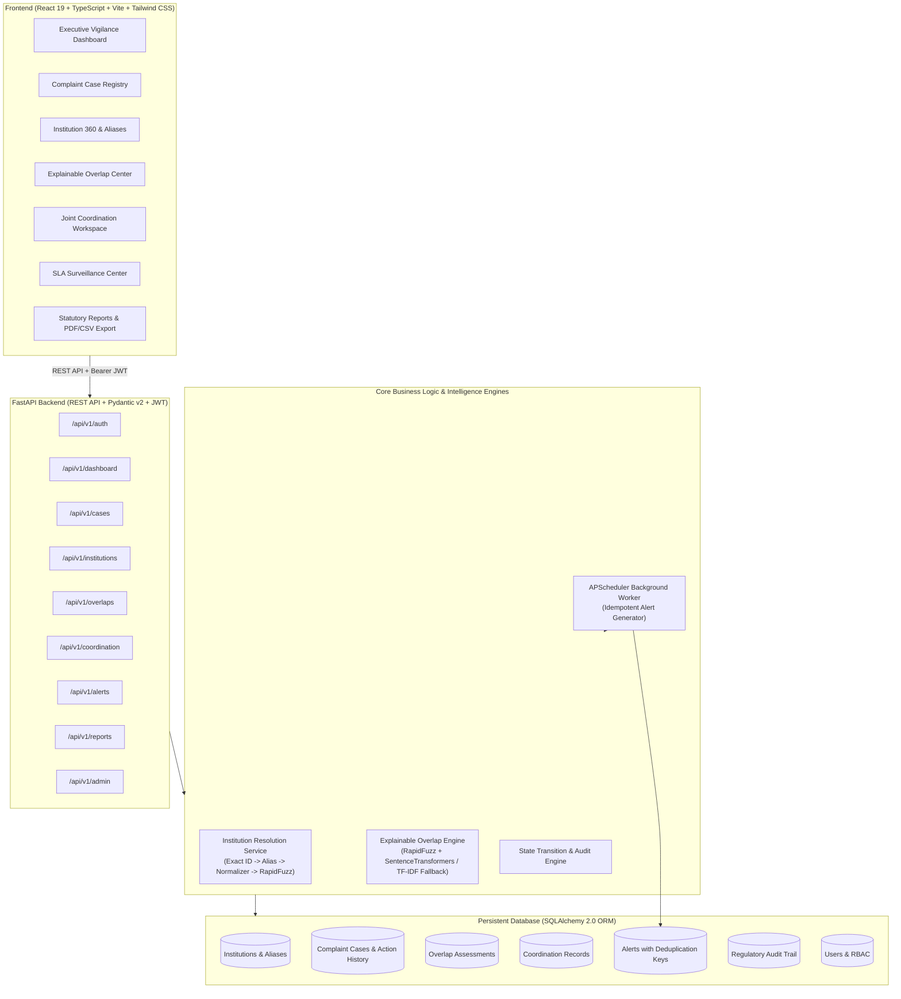

# Integrated AICTE Institution Complaint Monitoring and Coordination System
### Smart India Hackathon Problem Statement SIH26264

[](https://fastapi.tiangolo.com)
[](https://react.dev)
[](https://www.typescriptlang.org)
[](https://tailwindcss.com)
[](https://www.sqlalchemy.org)
[](https://www.python.org)
[](https://www.docker.com)

---

## 1. Problem Statement

The All India Council for Technical Education (AICTE) receives complaints concerning technical education institutions from students, faculty members, parents, and institutional stakeholders across India. Historically, these complaints are processed independently by different Bureaus and Cells:

- **Regulation Bureau (RB)**: Focuses on statutory compliance, academic standards, and regulatory violations.
- **Public Grievance Redressal Cell (PGRC)**: Focuses on individual student/faculty petitions, fee disputes, and discrimination.
- **Regional Offices (RO)**: Oversees localized field inspections, regional compliance, and territorial oversight.
- **Approval Bureau**: Handles institutional accreditation, intake quotas, and course approvals.

Without a centralized coordination and intelligence system, multiple Bureaus frequently handle complaints regarding the same institution in silos, causing:
1. **Duplicate inquiries and contradictory orders** issued to the same institution.
2. **Fragmented institutional complaint histories**, blinding officers to ongoing parallel proceedings.
3. **Statutory SLA breaches** due to lack of cross-bureau intervention.
4. **Delayed disposal** and administrative inefficiencies.

---

## 2. Proposed Solution

This application is an **Integrated Institutional Complaint Monitoring, Identity Resolution, Cross-Bureau Coordination, and Explainable Overlap Detection System**.

Rather than automating regulatory decisions, the engine acts as an **explainable decision-support copilot** for authorized officers:
- Flags institutions with active cases across multiple Bureaus.
- Highlights textual, categorical, and institutional relationships with transparent explanations and confidence scores.
- Empowers officers to confirm, dismiss, or coordinate actions through a shared **Coordination Workspace** without stripping individual Bureaus of case autonomy.
- Safeguards statutory deadlines via an idempotent SLA surveillance scheduler.

---

## 3. High-Level Architecture



---

## 4. Technology Stack

### Frontend
- **Framework**: React 19, Vite, TypeScript
- **Styling**: Tailwind CSS with an official Indian Government / AICTE Navy theme (`#0a192f`, `#0f2942`, subtle saffron & green accents)
- **Data Visualization**: Recharts (Workload bar charts, Status pie charts, Ageing brackets, Monthly velocity)
- **Icons**: Lucide React
- **Routing**: React Router v7 with URL search-params synchronization
- **Architecture**: Modular layout, API abstraction layer, optimistic updates, and loading skeletons

### Backend
- **Framework**: FastAPI (Python 3.12)
- **ORM & Database**: SQLAlchemy 2.0 with persistent SQLite (PostgreSQL-compatible schema)
- **Validation**: Pydantic v2 & Pydantic Settings
- **Authentication**: JWT (JSON Web Tokens) with direct bcrypt password hashing
- **Intelligence**: RapidFuzz (lexical n-gram Jaccard & token sort ratio) + Sentence-Transformers (`all-MiniLM-L6-v2`) with graceful Scikit-learn TF-IDF cosine similarity fallback
- **Scheduler**: APScheduler for idempotent background SLA monitoring
- **PDF & CSV Engine**: ReportLab (official landscape PDF reports) & RFC 4180 CSV export
- **Testing**: pytest & FastAPI TestClient

---

## 5. Main Features

1. **Executive Real-Time Vigilance Dashboard**:
   - 8 live KPI metrics (Total, Pending, Under Process, Overdue, Transferred, Escalated, Disposed, Active Overlap Institutions).
   - Prominent Overlap Notice Banner alerting officers when parallel proceedings exist.
   - Priority Escalation Queue explaining precisely why each case is prioritized (SLA breach, approaching deadline, unreviewed cross-bureau overlap, unresolved identity).
   - 5-second non-blocking polling and manual refresh button.
2. **Deterministic Institution Resolution Pipeline**:
   - 5-tier matching priority: Exact AICTE Permanent ID -> Verified Alias -> Normalized Official Name -> Fuzzy Name Matching with geographic reinforcement.
   - Ambiguity Queue: Ambiguous or unverified institution names are placed into an administrative review queue.
   - Conflicting Identity Guard: If two records have different verified AICTE Permanent IDs, the engine will **never** automatically merge them, even if names are identical.
3. **Explainable Overlap Detection Engine**:
   - Compares active complaints involving the same institution across Bureaus.
   - Categorizes relationships into **Potential Duplicate**, **Potential Issue Overlap**, or **Institution Overlap**.
   - Generates transparent, human-readable explanations and actionable recommendations.
   - Decision Persistence: Dismissed pairs are recorded with officer identity and mandatory justification; dismissed pairs are never recreated unless material case details change.
4. **Cross-Bureau Coordination Workspace**:
   - Links cases across multiple Bureaus under a shared coordination workspace.
   - Preserves individual case autonomy, bureau records, and independent statuses.
   - Tracks joint review milestones and unified consensus outcomes.
5. **Full Case Lifecycle & Statutory SLA Guardian**:
   - Lifecycle operations: Lodging, Action notes, Bureau transfers, Escalations, Disposal (with mandatory >= 10 character closure findings), and Authorized Reopening (restricted to Senior Management/Admin with mandatory rationale).
   - Idempotent alert generation: deduplication keys prevent repeated notifications.
6. **12 Certified Regulatory Reports with CSV & PDF Export**:
   - Generates Bureau Workload, Status Distribution, Ageing Analysis, SLA Compliance, Cross-Bureau Overlaps, and Case Registries with live table preview, RFC 4180 CSV, and ReportLab PDF downloads.

---

## 6. Database Schema Design

| Table Name | Primary Key | Key Foreign Keys & Constraints | Description |
| :--- | :--- | :--- | :--- |
| `institutions` | `id` (Int) | `aicte_permanent_id` (Unique, Nullable) | Official institution master directory |
| `institution_aliases` | `id` (Int) | `institution_id` -> `institutions.id` | Verified institutional abbreviations and aliases |
| `complaint_cases` | `id` (Int) | `case_id` (Unique), `institution_id` (Nullable), `assigned_officer_id` | Core complaint dossier and procedural status |
| `action_histories` | `id` (Int) | `case_id` -> `complaint_cases.id`, `actor_user_id` | Immutable chronological action journal |
| `overlap_assessments` | `id` (Int) | `case_a_id`, `case_b_id` (Unique Constraint: `case_a_id < case_b_id`) | Explainable overlap calculations & decisions |
| `coordination_records`| `id` (Int) | `responsible_officer_id` -> `users.id` | Joint inter-bureau coordination workspaces |
| `coordination_cases`  | `id` (Int) | `coordination_id`, `case_id` | Many-to-many junction table for linked cases |
| `users` | `id` (Int) | `email` (Unique) | Officers, management, and administrators |
| `alerts` | `id` (Int) | `deduplication_key` (Unique, Indexed) | Idempotent SLA & surveillance notifications |
| `audit_events` | `id` (Int) | `actor_user_id` -> `users.id` | Security and administrative audit trail |

---

## 7. Role-Based Access Control (RBAC) Matrix

| Operation / Feature | RB Officer | PGRC Officer | Regional Officer | Senior Management | Admin |
| :--- | :---: | :---: | :---: | :---: | :---: |
| View Surveillance Dashboard | Yes | Yes | Yes (Regional) | Yes (All) | Yes (All) |
| Lodge Complaint Case | Yes | Yes | Yes | Yes | Yes |
| Record Action Notes on Own Bureau Cases | Yes | Yes | Yes | Read-Only | Yes |
| Transfer Case to Another Bureau | Yes | Yes | Yes | Yes | Yes |
| Escalate Case to Senior Management | Yes | Yes | Yes | Yes | Yes |
| Dispose Case (with mandatory findings) | Yes | Yes | Yes | No | Yes |
| Reopen Disposed Complaint | No | No | No | **Yes** | **Yes** |
| Confirm / Dismiss Overlap Suggestion | Yes | Yes | Yes | Yes | Yes |
| Manage Verified Aliases & Identity Queue | No | No | No | No | **Yes** |
| Export Reports (CSV / PDF) | Yes | Yes | Yes | Yes | Yes |
| View System Audit Logs | No | No | No | **Yes** | **Yes** |
| User Account Provisioning | No | No | No | No | **Yes** |

---

## 8. Demo Credentials

For quick evaluation during demonstrations, the portal includes an **Evaluator Persona Quick-Switcher** on both the login screen and the navigation header:

| Role | Email | Password | Primary Purpose |
| :--- | :--- | :--- | :--- |
| **RB Officer** | `rb.officer@aicte.gov.in` | `Password@123` | Regulation Bureau compliance & enforcement |
| **PGRC Officer** | `pgrc.officer@aicte.gov.in` | `Password@123` | Public Grievance Redressal Cell investigations |
| **Regional Officer** | `regional.officer@aicte.gov.in` | `Password@123` | Western Regional Office inspections |
| **Senior Management** | `senior.mgmt@aicte.gov.in` | `Password@123` | Executive council oversight & case reopening |
| **Admin** | `admin@aicte.gov.in` | `Password@123` | Identity resolution queue & user provisioning |

---

## 9. Quick Start Guide

### Option A: One-Command Startup (Docker Compose)
Ensure Docker is installed and running, then execute:
```bash
docker compose up --build
```
- Frontend UI: `http://localhost:5173`
- Backend API Docs (Swagger): `http://localhost:8000/docs`

---

### Option B: Local Development Startup

#### 1. Backend Setup:
```bash
cd backend
python -m venv venv
.\venv\Scripts\pip install -r requirements.txt
.\venv\Scripts\python -m app.seed
.\venv\Scripts\uvicorn app.main:app --reload --port 8000
```

#### 2. Frontend Setup (in a separate terminal):
```bash
cd frontend
npm install
npm run dev -- --port 5173
```
Open `http://localhost:5173` in your browser.

---

## 10. Database Seed & Reset Commands

To reset the database and repopulate synthetic test records (40 institutions, 280 cases, 15 planted overlap scenarios, and idempotent alerts):
```bash
cd backend
.\venv\Scripts\python -m app.seed
```

---

## 11. Automated Test Suite

Run the complete automated pytest suite:
```bash
cd backend
.\venv\Scripts\python -m pytest -v app/tests
```
**Test Coverage Includes:**
- Institution identity resolution (Exact ID, Verified Aliases, Normalization, Conflicting IDs prevention)
- Explainable Overlap Engine (Lexical + Semantic calculation, Disposed cases exclusion, Dismissal persistence)
- Case lifecycle transitions (Creation, Actions, Transfers, Escalation, Disposal validation, Authorized Reopening)
- SLA monitor and alert idempotency
- API authentication, dashboard KPI aggregations, and CSV/PDF export validation

---

## 12. Three-Minute Live Demonstration Script (For SIH Judges)

| Time | Stage | Action & Talking Points |
| :--- | :--- | :--- |
| **0:00 - 0:30** | **Login & Dashboard** | Log in as **RB Officer** (`rb.officer@aicte.gov.in`). Show the **AICTE Surveillance Dashboard** with real-time KPI cards (280 cases received, overdue cases, 40 institutions under surveillance). Highlight the prominent **"POTENTIAL OVERLAPPING CASES: COORDINATION REQUIRED"** banner. |
| **0:30 - 1:15** | **Central Overlap Scenario** | Click **Launch Overlap Intelligence**. Select the central SIH scenario for **Vivekanand Education Society's Institute of Technology (VESIT Mumbai)**. Explain that Case A (`AICTE-PGRC-2026-00010`) is a student petition regarding AI elective faculty shortage under PGRC, while Case B (`AICTE-RB-2026-00011`) is a statutory inspection notice under Regulation Bureau. Point out that descriptions differ, yet the explainable engine caught the relationship (100% Institution match, 100% Category match, 64% Text similarity). |
| **1:15 - 1:50** | **Confirm Overlap & Joint Coordination** | Click **Confirm Overlap**. Enter coordination notes: *"Initiating joint fact-finding hearing between RB and PGRC desks."* Click Confirm. Navigate to **Coordination Space** in the sidebar to show the newly initialized joint workspace linking both cases. |
| **1:50 - 2:30** | **Case Lifecycle & Statutory Actions** | Open Case `AICTE-RB-2026-00011`. Show the immutable chronological audit timeline. Click **Transfer Bureau**, transfer to `Regional Office (RO)` for inspection, and observe that the case status immediately updates to `Transferred` and appends to the history. Click **Dispose Case**, show validation when closure remarks are too brief, enter formal findings, and verify disposal. |
| **2:30 - 3:00** | **Reports & PDF Export** | Navigate to **Reports & Analytics**. Select **Statutory SLA Compliance Summary**. Demonstrate live table calculation. Click **Export Official PDF** to download the certified ReportLab PDF report containing generation timestamp and filter criteria. |

---

## 13. Known Limitations & Technical Notes
1. **Semantic Model Caching**: In offline test environments or behind restricted proxies, the system automatically falls back to Scikit-learn TF-IDF cosine similarity + RapidFuzz token set ratio without interrupting core application workflows.
2. **Synthetic Data**: All institution names, student allegations, and regulatory records are synthetic for Smart India Hackathon problem SIH26264. Synthetic allegations are not attributed to real institutions.
3. **Database Driver**: The local prototype operates on SQLite (`aicte_complaints.db`). The SQLAlchemy models and Alembic schema are PostgreSQL-ready for cloud production deployment.
